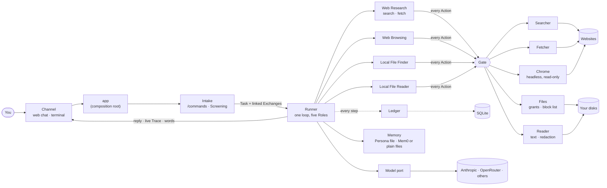

# Architecture

One Python process on the laptop. A web page (or the terminal) talks to it; it talks to a model provider and to websites; everything else stays on the machine. Vocabulary: **module** (anything with an interface and an implementation), **interface** (everything a caller must know), **seam** (where behaviour can change without editing in place), **adapter** (a thing that fills a seam), **depth** (behaviour behind a small interface). Domain words (Task, Run, Exchange, Taint, Finding...) are in [`CONTEXT-MAP.md`](../CONTEXT-MAP.md).

## 1. The shape



A message becomes a Task. The **Orchestrator** (the only agent that talks to you) plans 1 to 3 steps and delegates them one at a time. Each specialist is the same loop with its own prompt, model and exactly one kind of tool, and hands back a short **Finding**. Every Action of every Role passes the one **Gate** before a Tool runs. An **agent** is anything that calls the Model port: the five Roles, plus Screening and the Search Summarizer, which are single calls outside the loop.

## 2. Modules

| Module | Interface (what a caller learns) | Hides | Code |
|---|---|---|---|
| **Channel** | `messages()` stream · `send(reply)` · `trace(event)` · a `cancel` flag (Stop) | WebSocket, HTTP API, history, queue of waiting messages, the live browser stream, Host/Origin guard; or stdin/stdout | `channels/web.py`, `channels/cli.py` |
| **Intake + Screening** | `read(message) → NewTask · Chat · Declined · Command · Failed` | `/commands`, then **one cheap model call**, shown the chat's last 5 Exchanges whole (a reply Screening gave itself counts), that declines, answers a greeting, or passes the message on with the Exchanges it depends on; fails open | `intake.py`, `screening.py` |
| **Runner** | `submit(task, previous, screening_cost)` | the agent loop, Roles, plan and delegation, Budget, Stop, repeat guard, note trimming, Taint, Trace and Ledger rows, streaming of the final answer | `runner.py`, `roles.py` |
| **Gate** | `check(action, role's kinds, ctx) → Allow · Refuse` | every rule: the Role's tool set, "no web after a file read", each capability's own rule | `gate.py` |
| **Capability** (registry) | one subclass per tool: name, blurb, `tool` (derived from its Action class), `reaches_web`, `run`, `check`, `summary` | schema, validation, trace line, repeat rules | `capabilities/*` |
| **Tool implementations** | each is called through its Tool with plain data | their own limits (below) | `fetch.py`, `browser.py`, `files.py`, `reader.py`, `redact.py`, `search.py` |
| **Model port** | `call(request, on_text=None) → one Action, its cost, tokens, duration, attempts` | tool formats, provider errors, prices, streaming, **retries: one policy, every attempt recorded** ([ADR 0015](adr/0015-one-retry-policy-at-the-model-port.md)) | `model.py`, `pydantic_model.py`, `retry.py`, `scope.py` |
| **Memory** | `recall(request)` · `record_run` · `learn` · `remember` · `edit` · `forget` · `forget_chat` | Persona (a Markdown file the User owns), the learned store behind one seam (plain files or Mem0), the Recollection budget, what may write it ([ADR 0016](adr/0016-memory-on-mem0-behind-the-seam.md)) | `memory.py`, `persona.py`, `memory_files.py`, `memory_mem0.py`, `extract.py`, `commands.py` |
| **Chats** | `rename` · `delete` (purge, after-delete hooks) | what leaves with a deleted chat: rows, screenshots, Capture, what Memory kept | `chats.py` |
| **Ledger + Store** | `record(event)` · `start_run` / `end_run` · `save_message` · `close_interrupted` · `month_spend` · read-only `history` | SQLite, migrations (copied first), chat titles, tokens, durations and attempts per step, what the month has cost | `ledger.py`, `store.py`, `history.py` |
| **Log + Capture** | the app log file; opt-in prompts and replies per Run | rotation, ids on every line, no contents; Capture is refused for a Run that read a file | `logs.py`, `capture.py`, `housekeeping.py` |
| **Contract** | the page's wire types as Pydantic models | what the page and the backend promise each other | `contract.py`, [`ui-contract.md`](ui-contract.md) |

**Deletion test.** Without the Gate its rules reappear inside every tool; without the Ledger every module invents its own logging and cost maths; without the capability registry the Runner, Gate and model adapter each learn every tool by name. A separate "router" or "planner" module would only pass through, so neither exists.

## 3. Roles: one loop, five of them

A **Role** is a prompt, a tool set, a model and a step cap ([ADR 0010](adr/0010-one-loop-many-roles.md)). The loop is one function.

| Role (agent) | Model | Action cap | Its one tool |
|---|---|---|---|
| **Orchestrator** | Sonnet 5 | 8 | none: `plan`, `delegate`, `answer` |
| **Web Research** (`web_research`) | Haiku 4.5 | 5 | `web_search`, `fetch` |
| **Local File Finder** (`local_file_finder`) | Haiku 4.5 | 6 | `files`: names, sizes, dates, counts; never contents |
| **Web Browsing** (`web_browsing`) | Sonnet 5 | 8 | `browse`: open, follow a numbered link, read on; read-only |
| **Local File Reader** (`local_file_reader`) | Haiku 4.5 | 3 | `read_text`: text of one file or PDF |

Rules: a specialist can only take its own tools (offered, and enforced by the Gate); one Budget (default $1, `STEPOUT_TASK_CAP_USD`), one Taint flag and one Ledger per Run, shared by all Roles; a Finding is untrusted data, never an instruction; delegation is one level deep; one Run at a time across all chats.

## 4. A message's journey

```
You: "What's the news in New York today?"
 Channel ─► app ─► Intake.read ─► Screening (one Haiku call, temperature 0)      proceed, links to no earlier Exchange
 app ─► Runner.submit(task)                                                       Run starts, Budget $1
   Orchestrator   plan: Web Research: "find today's headlines"                    step event → page
   Web Research   web_search "..."  ─► Gate: Allow ─► Searcher (one cheap call)   step event, cost charged
   Web Research   answer (Finding)                                                return event
   Orchestrator   answer: markdown with links      ── words streamed to the page as they are written ──
 Runner ─► reply (saved, then sent) ─► Ledger: Run ends Done, cost, tainted?
```

A Run ends `done`, `failed` (a plain line says why) or `cancelled` (Stop, or the Budget). Pause and resume do not exist yet ([roadmap](roadmap.md)).

## 5. Safety model

Read-only: no typing, submitting, uploading, downloading, deleting or paying. Each line is enforced in code and has a test.

- **Gate.** Role tool sets; `reaches_web` capabilities are refused for a tainted Run.
- **Taint.** Once file contents have entered a Run, the web is closed for the rest of it and for any later Run that builds on its answer ([ADR 0008](adr/0008-laptop-files-grants.md), [0010](adr/0010-one-loop-many-roles.md)). A tainted reply is not streamed and its links are filtered (`links.py`), so a file cannot make the reply carry its own text out in a URL.
- **Files.** Only through Grants (`data/config/grants.toml`, edited by the User only) and a fixed block list (credentials, keys, browser profiles, Windows, the assistant's own folder); real paths are resolved first.
- **Reader.** At most 20 files, 10 MB and 40,000 characters a file per Run; a hostile PDF is bounded in time and memory; secret-looking values become `[redacted]` before any model sees the text.
- **Network.** Fetcher and Chrome check every request and every redirect hop; private, local and non-http(s) addresses are refused. Chrome is a fresh headless context per Run: no cookies, logins or downloads.
- **Page.** Listens on `127.0.0.1` only; checks Host and Origin on everything; model output is rendered without HTML or images and with safe links only.
- **Money.** $1 per Run across all agents, and a monthly limit (`STEPOUT_MONTH_CAP_USD`, default $10) that also caps a Run at what the month has left; a model with no known price fails the Run instead of reading as free; a retry never starts past the cap.
- **Memory.** Only the User's messages and a Run's own outcome write it; a page or a file that asks to be remembered changes nothing. A Run that read a file leaves its request and outcome only, and what a Run did is kept as kinds and hosts, never wording a page could have chosen. Recollection is data about the User, never an instruction or a permission, and shown to the Orchestrator only. Memory never fails or delays a Run.
- **Record.** The Ledger holds sizes and paths, not what a tool returned. The app log writes an exception's message only for types that cannot echo their input. Capture (opt-in) is never written for a Run that has read a file.

## 6. Seams and adapters

A seam is real when two adapters exist (a test double counts).

| Seam | Adapters |
|---|---|
| **Channel** | web (aiohttp + React page), terminal; test fakes |
| **Model** | Anthropic SDK (default; streams the final answer), Pydantic AI (any provider, e.g. OpenRouter; opt-in with `STEPOUT_STRONG_MODEL` / `STEPOUT_CHEAP_MODEL`), scripted (tests) ([ADR 0011](adr/0011-pydantic-ai-as-the-plumbing.md)) |
| **Screener** | Screening's Haiku call; a fixed one in tests |
| **Learned store** | plain files (`memory_files.py`), Mem0 (`memory_mem0.py`, primary when `OPENAI_API_KEY` is there), a fake embedder in tests ([ADR 0016](adr/0016-memory-on-mem0-behind-the-seam.md)) |

Deliberately not seams: Chrome, Fetcher, Files (one adapter each, tested against real Chrome, a local server and temp folders) and Store (SQLite). Actions and Results are plain data, so a Tool's implementation can run elsewhere later ([ADR 0007](adr/0007-brain-and-hands.md)).

## 7. On disk and in the repo

```
.env                      ANTHROPIC_API_KEY (OPENAI_API_KEY for Mem0's embeddings, OPENROUTER_API_KEY if used); never committed
data/config/grants.toml   the folders it may see (template: grants.example.toml)
data/stepout.db           SQLite: events, tasks, runs, chats (migrations in src/stepout/migrations; a copy is made first)
data/logs/stepout.log     the app log: JSON lines, rotating, chat and run ids on each line
data/memory/              persona.md (yours), learned.jsonl (plain files) or Mem0's store (qdrant/, mem0/)
data/capture/<run>.jsonl  prompts and replies, only with STEPOUT_CAPTURE=1
data/runs/<run>/<n>.jpg   page screenshots of a Run (removed with their chat, or after STEPOUT_RETENTION_DAYS)
src/stepout/              the backend (this document)
web/                      React + Vite + TypeScript page; src/, mock/ (replays fixtures), e2e/ (real Chrome), dist/ is build output
tests/                    offline suite with a scripted model; support/ holds fakes and the acceptance world
scripts/acceptance.py     eight queries through the real wiring; offline by default, --live spends money
docs/                     this map, decisions (adr/), history, roadmap, the wire contract
```

## 8. Testing

The interface is the test surface: the offline suite drives the real app loop, Runner, Gate, Reader and Store with a scripted model, and real Chrome against local pages. `scripts/acceptance.py` runs eight queries on an invented folder (a planted injection included); `--live` runs them on real Claude for about $0.30. `pytest -m eval` holds the paid live checks. The page has component tests (Vitest), a mock backend, and real-Chrome flows.

## 9. Ceilings, not bugs

Stop ends a Run within a moment, but a PDF parse or a files walk already running in its worker thread continues until it returns · a malformed model reply is asked for again once, then fails the Run with a plain line · the 10 MB read limit is one total per Run · whole-drive counts are partial by design (a 60 s clock) · names and paths from `list`/`find` go to the model API (counts do not) · a folder swapped for a link between resolve and walk is not caught (walks never follow links) · Fetcher does not guard against DNS rebinding between the check and the connect · the words stream only for the Orchestrator's final answer, on the Anthropic adapter · the Orchestrator sometimes over-plans · the Web Research step cap (5) is untuned · Mem0's own call to the embedding provider keeps its own retries and its cost is an estimate from text size · relevance (words in common, or an embedding search) is untuned · one process may hold the Mem0 store, and closing interrupted Runs at start assumes one process per data folder · Memory and chat search have no full-text index (a substring scan, fine for thousands of messages) · a stream that is cut is charged an estimate, not the provider's figure · Browser navigation has no retry · the retry numbers (3 attempts, 1 to 8 s, 8 retries and 60 s a Run) are starting values.
